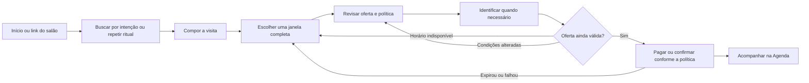

# Arquitetura e organograma do App Cliente KortexOS

**Proposta de produto · 2026-11-25 · Base analisada `ce68cfb`**

O App Cliente reúne descoberta, agendamento e retorno para negócios de beleza, barbearia e bem-estar. A navegação tem quatro destinos fixos, **Início, Explorar, Agenda e Conta**. Da escolha do primeiro serviço à confirmação, um único fluxo mantém o carrinho visível e revela profissional, horário, identidade e pagamento conforme a etapa.

A decisão central é oferecer **uma janela para a visita inteira**. A API pública atual calcula e reserva um serviço por vez. A evolução para vários serviços exige que o servidor valide todas as etapas, ofereça um horário com preço e duração definidos e grave a visita de forma atômica.

## Organograma funcional

| Área | Conteúdo e ações |
|---|---|
| **0 · Entrada e identidade** | Catálogo aberto como visitante. O link do salão define o contexto inicial. Unidade favorita ou localização, quando disponíveis e autorizadas, sugerem um local que o cliente pode trocar manualmente. A identificação entra na confirmação ou no acesso a dados pessoais. Apple, Google e código por WhatsApp dependem dos provedores habilitados. Biometria usa uma credencial elegível já cadastrada. |
| **1 · Início** | A Home do visitante prioriza busca e catálogo. Para quem já tem histórico, exibe saudação, saldo e “Repetir último ritual”, com os mesmos serviços, preferência pelo último profissional e até três horários revalidados. Quatro blocos Bento dão acesso a Rituais, Clube, Vale-presente e Home Care. Recomendações de retorno aparecem abaixo da ação principal. |
| **2 · Explorar** | Busca por objetivo e data, como “Tenho um casamento sábado”, “Aliviar tensão nas costas” e “Manutenção mensal”. Filtros Hoje, Amanhã, Fim de semana e Cashback extra. Os cards mostram resultado esperado, foto editorial, duração, preço e crédito estimado quando elegível. Prova social exige amostra e período observados. Sem correspondência, a interface sugere outras buscas ou abre o catálogo. |
| **3 · Agendamento** | Carrinho persistente permite incluir, remover e editar serviços. “Sem preferência” é o padrão. Especialistas elegíveis mostram avatar, especialidade, última visita e nota quando houver avaliação disponível. Cada horário comporta a visita inteira. O complemento informa tempo e preço adicionais. O upgrade apresenta a diferença, como “+R$ 35 pelo ritual completo”. Qualquer alteração nos serviços recalcula as janelas. |
| **4 · Revisão e pagamento** | A revisão mostra unidade, serviços, profissionais, início e fim, produtos, saldo aplicado, total e política de cancelamento. Home Care usa afinidade ou janela de reposição e oferece retirada quando houver estoque. Créditos são exibidos em reais, com controle de ajuste e ação para usar o saldo elegível. Pix, Apple Pay, Google Pay e cartão tokenizado aparecem conforme elegibilidade. Sinal ou garantia vêm com valor, prazo e condição de devolução explícitos. |
| **5 · Agenda** | Próxima visita com horário, endereço, equipe e status. Check-in conforme janela operacional, rota em Maps ou Uber e calendário. Wallet Pass e Live Activity entram quando disponíveis. Remarcação e cancelamento seguem o prazo e mostram a consequência antes da ação. O histórico reúne visitas, produtos e detalhes técnicos autorizados, com opção de repetir cada visita. |
| **6 · Conta e carteira** | Saldo disponível, valores a expirar, datas e extrato. Clube com status, créditos, regras do plano e faturas. Preferências como silêncio, conversa e bebida, além de dados fiscais e meios de pagamento salvos. O tratamento de alergias depende de avaliação jurídica, finalidade e controle de acesso. |

## Jornada e interação

- **Lei de Hick.** A Home prioriza uma ação de retorno para clientes com histórico e uma ação de busca para visitantes. O Bento oferece até quatro atalhos.
- **Revelação progressiva.** O carrinho acompanha o cliente enquanto ele explora. A escolha de equipe e horário aparece quando há uma composição de serviços. A revisão mantém o carrinho ao retornar da identificação ou ao recuperar um conflito.
- **Ancoragem de valor.** Um upgrade mostra o acréscimo em reais e minutos. Se afetar a janela escolhida, a interface pede nova seleção antes de seguir.
- **Retenção.** O saldo elegível aparece com valor e validade. As sugestões de retorno usam a frequência observada e só mostram horários revalidados.
- **Acessibilidade.** Alvos de toque de pelo menos 44 px no protótipo web, foco visível, rótulos acessíveis e mensagens de status anunciadas. Horário selecionado, erro e saldo a expirar têm indicação além da cor.

## Contratos propostos

### Catálogo, intenção e localização

Busca por tags e sinônimos atende a primeira versão do fluxo simulado. Uma evolução semântica pode interpretar objetivo e data e ranquear o catálogo elegível. O catálogo e o motor de agenda continuam responsáveis por preço, duração, profissionais e horários. A unidade vem do contexto validado pelo servidor. A troca de unidade reavalia carrinho, estoque, oferta e benefícios. A escolha manual está disponível quando o cliente recusa localização.

### Disponibilidade para a visita inteira

Cada etapa tem serviço, duração efetiva por profissional, ordem, executores elegíveis, recursos e intervalos exigidos. O cálculo considera escalas, folgas, ocupação, antecipação mínima, buffers e uso de salas e equipamentos. Serviços sequenciais podem passar por profissionais diferentes dentro da mesma janela quando houver disponibilidade e transição viável. Serviços paralelos exigem compatibilidade explícita, recursos disponíveis e regras que permitam execução simultânea. A duração total vai do início da primeira etapa ao fim da última.

“Sem preferência” ordena horários considerando a visita completa. “Horário inteligente” pode incentivar períodos elegíveis, com cashback extra definido pela política comercial. Incentivos e complementos dependem de oferta válida e preço calculado pelo servidor.

### Oferta, reserva e remarcação

A oferta versionada vincula unidade, etapas, horários, profissionais, preço, regras e validade. Mudanças no carrinho ou no contexto invalidam a seleção anterior. Na confirmação, o servidor verifica identidade quando exigida, validade, condições e disponibilidade. A reserva grava toda a visita ou nenhuma etapa. Uma chave de idempotência deduplica reenvios da mesma operação.

Conflito de horário preserva os itens e apresenta novas janelas. Mudanças em preço, duração ou política pedem revisão explícita. A remarcação mantém a visita original até o servidor garantir a substituta. O cancelamento aplica o prazo da visita e informa as consequências de pagamento, crédito e estoque.

### Pagamento, carteira e comércio

Para pagamento online, a jornada distingue reserva temporária, pagamento pendente, confirmação, expiração e cancelamento. O servidor valida a notificação do gateway e a processa de forma idempotente. Se o pagamento chegar após a expiração, a conciliação resolve a cobrança sem recriar uma reserva que possa ter sido ocupada. O checkout exibe o prazo e oferece recuperação com o carrinho preservado.

O extrato registra emissão, resgate, expiração e reversão do crédito, com referência à operação de origem. Estoque de Home Care e retirada são confirmados por unidade. A sugestão pode associar barboterapia ao óleo usado no atendimento ou indicar reposição pelo ciclo de compra. Preço, saldo, estoque, agenda e valores financeiros são autoritativos no backend.

### Identidade e dados do cliente

A identidade de cliente tem vínculo verificado e permissões próprias. O link pessoal atual dá acesso à visita correspondente dentro do seu escopo e prazo. O histórico, a carteira e a ficha exigem identidade adequada. Preferências técnicas podem registrar medidas de corte e fórmulas com acesso controlado. Login social, WhatsApp OTP, biometria, Wallet e Live Activity dependem de compatibilidade e integração verificadas.

## Estado do KortexOS e evolução

| Classificação | Evidência e implicação |
|---|---|
| **REAL no código** | Catálogo público, seleção sem preferência, grade pela duração efetiva, revisão de oferta e reserva atômica de um serviço. Link pessoal com confirmação, cancelamento e remarcação atômica. D-063, D-068 e D-069. [Rotas públicas](../../backend/src/routes/publicBooking.js) |
| **PARCIAL** | O atendimento interno aceita vários serviços. A consulta pública de horários recebe um único `servicoId`. Há planos e créditos com cobrança manual. A visita encadeada pública, a área do assinante e a cobrança automática exigem evolução. [Estado do projeto](../PROJECT_STATE.md) |
| **BLOQUEADO para operação** | O link público consta como desligado. A ativação depende de aviso de privacidade aprovado, dados do salão no aviso e Red Team com o link ligado. Rede multiunidade segue a direção da D-073 para V1.5. Evoluções de regra, integrações e schema dependem das autorizações registradas. [Estado do projeto](../PROJECT_STATE.md) · [Decisões](../DECISIONS.md) |
| **MOCKADO** | O Floot usa catálogo, agenda, identidade, pagamentos, cashback, histórico e clube simulados. Calcula janelas sequenciais para um mesmo profissional. A especificação cobre encadeamento entre profissionais e paralelismo. |

A sequência de evolução começa pela validação do fluxo público de um serviço e da recuperação de conflitos. A etapa seguinte é a oferta e reserva da visita inteira. Identidade do cliente, pagamento e carteira dependem de contratos de integração e decisões comerciais. Clube, recomendações, vale-presente e Home Care evoluem conforme dados, estoque e integrações.

## Benchmark e medidas

As referências do briefing orientam hipóteses de interação. As metas devem partir de uma linha de base da jornada atual, com acompanhamento por unidade e perfil de cliente.

| Referência | Aplicação | Medida |
|---|---|---|
| Uber e iFood | Contexto de unidade e repetição de ritual com serviços e horários revalidados. | Tempo até escolher horário e início de reservas pelo atalho. |
| Airbnb | Objetivo e data como entrada da busca. | Buscas sem resultado e conversão da busca em adição ao carrinho. |
| Amazon | Complementos, Home Care por afinidade e reposição com retirada. | Inclusão de produtos e abandono após a sugestão. |
| Nubank e Apple Pay | Uso de saldo em reais, total líquido e métodos rápidos quando elegíveis. | Conversão, falhas e tempo de pagamento por método. |
| Spotify | Curadoria conforme ciclo de retorno e memória técnica da visita. | Uso da ação de repetir e taxa de retorno por coorte. |

## Critérios de aceite

| Cenário | Resultado esperado |
|---|---|
| Visitante, busca e login | Explora e revisa a oferta como visitante. A identificação preserva os serviços escolhidos e a oferta válida, ou informa a mudança antes de confirmar. |
| Combinação inviável | A interface apresenta alternativas de data, profissional ou composição de serviços. Cada horário exibido atende a todas as etapas. |
| Concorrência e alteração de oferta | Na disputa pela mesma janela, só uma reserva prevalece. Se preço, duração ou política mudarem, o cliente revisa as novas condições. |
| Remarcação e cancelamento | Uma falha ao remarcar preserva a visita anterior. O cancelamento mostra impacto, atualiza a agenda e concilia saldo, cobranças e estoque. |
| Pix, expiração e reenvio | Pix pendente aparece como pendente. Expiração oferece recuperação. Webhook repetido e duplo envio geram um único resultado financeiro e de agenda. |
| Acessibilidade | O fluxo funciona com teclado e leitor de tela. O foco acompanha a etapa ativa e as mensagens de status são compreensíveis sem depender da cor. |

## Artefatos e evidências do protótipo

- Organograma editável no FigJam. [KortexOS Cliente · Organograma](https://www.figma.com/board/wOWC8xZAOXpHG28hIzXikH)
- Quinze telas editáveis no Figma, com a jornada principal ligada. Parte da navegação auxiliar ficou pendente após atingir a cota do Figma. [KortexOS Cliente · Experiência de agendamento](https://www.figma.com/design/xTTfF97FNj6etwk0Dl6utT)
- Projeto **KortexOS Cliente · Protótipo** no Floot, ID `5ca219fa-001e-4643-bc41-7e1cbdca3d42`. A rota `/arquitetura` contém o resumo navegável. O acesso à prévia é gerado no Floot.
- O teste em navegador do protótipo verificou busca, ritual com dois serviços, recuperação após conflito, identificação e Pix simulados, agenda, remarcação e cancelamento. A validação de concorrência real, pagamentos e disponibilidade encadeada pertence à implementação futura.
